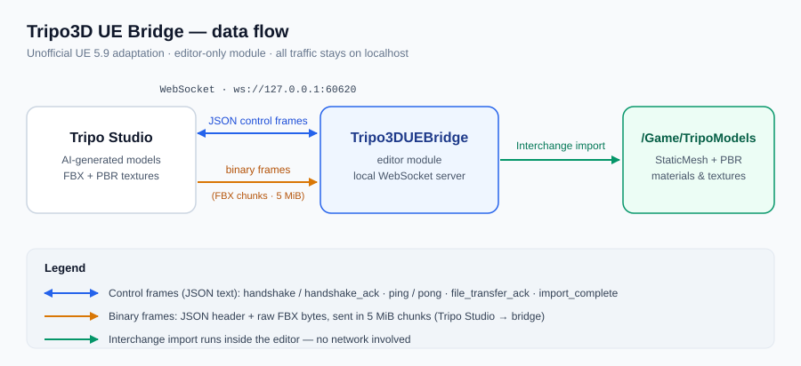

# Tripo3D UE Bridge — UE5.9 Adaptation

[](LICENSE)
[](https://github.com/zty828/Tripo3DUEBridge-UE5.9/releases)
[](https://github.com/zty828/Tripo3DUEBridge-UE5.9/actions/workflows/validate.yml)


**Unofficial community adaptation of the [Tripo3D](https://www.tripo3d.ai) UE Bridge plugin for Unreal Engine 5.9 (Preview).**

A WebSocket bridge that lets **Tripo Studio** push AI-generated 3D models (FBX + PBR textures) straight into the Unreal Editor. Open the bridge window, push from Tripo Studio, and the model lands in your Content Browser with materials and textures wired up automatically.

> ⚠️ **Provenance & license:** This repository is an *unofficial* port. The original plugin is **Copyright Tripo3D, All Rights Reserved**; this repo only adds the changes needed to build and run on UE 5.9. See [NOTICE.md](NOTICE.md) and [License](#license) before redistributing.

---

## Architecture / 架构



Tripo Studio connects to a local WebSocket server (`ws://127.0.0.1:60620`, protocol `1.0.0`) hosted by the **Tripo3DUEBridge editor module**. JSON control frames carry the handshake, heartbeats and transfer acknowledgements, while binary frames carry the model payload — a JSON header followed by raw FBX bytes, split into 5 MiB chunks. Once a transfer completes, the plugin imports the model through UE 5.9's **Interchange** pipeline into `/Game/TripoModels`, auto-building PBR materials and wiring up textures. All traffic stays on localhost, and the editor-only module never ships into packaged games.

> **中文：** Tripo Studio 通过本地 WebSocket（`ws://127.0.0.1:60620`）把模型推给编辑器模块：JSON 控制帧负责握手、心跳与确认，二进制帧按 5 MiB 分块传输 FBX；收齐后经 **Interchange** 导入 `/Game/TripoModels`，自动构建 PBR 材质并接好贴图。全程仅本机回环，模块只在编辑器中运行。

## Why this repo exists

Tripo3D ships precompiled bridge binaries for UE 5.4 – 5.8. Those binaries **will not load on UE 5.9**:

- The editor module's `.modules` manifest carries a **BuildId** locked to the engine it was built against, and the `.uplugin` pins `EngineVersion`. UE 5.9 rejects a mismatched module outright.
- UE 5.9's Interchange animation pipeline changed its API (`bSnapToClosestFrameBoundary` → `FrameAlignment`).

This repo takes the **pure-source** variant of the plugin and makes it build cleanly against UE 5.9, then ships a ready-to-use precompiled Win64 editor binary so you can drop it in without a compiler. **No C++ source changes were required** — the plugin's own `TripoVersionCompat.h` already gates the 5.8+ API behind `UE_VERSION_AT_LEAST(5, 8)`, which 5.9 satisfies. The only packaging fix was declaring the missing **Interchange** plugin dependency in the `.uplugin`.

Full technical details: [docs/ADAPTATION.md](docs/ADAPTATION.md).

## Compatibility

| Engine | Status |
| --- | --- |
| UE 5.9 (Preview, BuildId 60351404) | ✅ Built & module-load verified (this repo) |
| UE 5.8 | ✅ Supported by upstream source path |
| UE 5.4 – 5.7 | ✅ Source path supported (use upstream precompiled binaries if preferred) |

- **Platform:** Win64 only (the bundled `IXWebSocket.lib` and editor binary are Win64).
- **Module type:** Editor-only. It does not ship into packaged games.

## Features

- Local WebSocket server at `ws://127.0.0.1:60620` (protocol `1.0.0`).
- Receives chunked FBX + texture transfers from Tripo Studio (5 MB chunks, retry handling).
- Imports models into `/Game/TripoModels` via the UE 5.9 **Interchange** pipeline.
- Auto-builds PBR materials and imports/wires textures.
- Optional scene spawning of the imported asset.
- Editor window with live connection status, server start/stop, and a transfer log.
- Localized UI: en, zh-Hans, ja, ko, ru, fr, de, es, pt-BR.

## Install

### Option A — Drop-in (no compiler needed)

1. Copy the `Tripo3DUEBridge` folder (this repo's contents) into your project's `Plugins/` directory:
   ```
   YourProject/Plugins/Tripo3DUEBridge/
   ```
2. The precompiled editor binary is included at `Binaries/Win64/UnrealEditor-Tripo3DUEBridge.dll` (built for UE 5.9, BuildId 60351404).
3. Enable the plugin in **Edit → Plugins → Tripo3D → Tripo Bridge**, or add it to your `.uproject`:
   ```json
   { "Name": "Tripo3DUEBridge", "Enabled": true }
   ```
4. Restart the editor.

> The bundled DLL is tied to UE 5.9 BuildId **60351404**. On a different 5.9 build/hotfix the BuildId may differ — if the editor reports an incompatible module, rebuild from source (Option B).

### Option B — Build from source

Requirements:
- Unreal Engine **5.9** with C++ toolchain (Visual Studio 2022, MSVC v14.44+, Windows SDK 10.0.22621).
- The engine's bundled **zlib 1.3** (auto-detected by `Build.cs` under `Engine/Source/ThirdParty/zlib/1.3`).
- The bundled `ThirdParty/IXWebSocket/Lib/Win64/IXWebSocket.lib` (included).

Steps:
1. Place the plugin under `YourProject/Plugins/Tripo3DUEBridge`.
2. Delete the bundled `Binaries/` and `Intermediate/` if you want a clean rebuild.
3. Right-click your `.uproject` → **Generate Visual Studio project files**, then build the **Editor** target (or let Live Coding / the editor prompt compile it).
4. **Close any running editor before building** — an open editor holds the engine-wide Live Coding lock and UBT will refuse with `Unable to build while Live Coding is active`.

## Usage

1. Open the editor menu **Window → Tripo Bridge**. The window opens and the WebSocket server starts automatically on `ws://127.0.0.1:60620`.
2. In **Tripo Studio**, use the bridge/export-to-Unreal action and point it at the local bridge.
3. Push a model. The bridge receives the FBX + textures, imports into `/Game/TripoModels`, builds PBR materials, and (optionally) spawns the asset into the level.
4. Watch the transfer log in the bridge window; use **Start/Stop** to control the server and **Clear** to reset the log.

## Project structure

```
Tripo3DUEBridge/
├─ Tripo3DUEBridge.uplugin        # plugin descriptor (Interchange dependency declared)
├─ Source/Tripo3DUEBridge/        # C++ editor module (22 files)
│  ├─ Tripo3DUEBridge.Build.cs    # links IXWebSocket + engine zlib, version-aware
│  ├─ Public/                     # protocol, version-compat, interfaces
│  └─ Private/                    # WS server, importer, PBR builder, spawner, minizip
├─ ThirdParty/IXWebSocket/        # MIT-licensed WebSocket lib (headers + Win64 .lib)
├─ Content/                       # master PBR material + localized strings
├─ Config/                        # localization config
├─ Resources/                     # menu icon
├─ Binaries/Win64/                # precompiled UE5.9 editor DLL (+ .modules/.uclasses)
└─ docs/ADAPTATION.md             # UE5.9 adaptation notes
```

## License

The **adaptation contributions** in this repository are released under the [MIT License](LICENSE).

The **original Tripo3D UE Bridge code remains Copyright Tripo3D, All Rights Reserved**, and `IXWebSocket` is Copyright machinezone under MIT. This repo does not relicense upstream code. See [NOTICE.md](NOTICE.md) for the full provenance and third-party attributions. If you intend to redistribute commercially, confirm the terms with Tripo3D.

## Credits

- [Tripo3D](https://www.tripo3d.ai) — original Tripo3D UE Bridge plugin.
- [machinezone / IXWebSocket](https://github.com/machinezone/IXWebSocket) — WebSocket library (MIT).
- UE 5.9 adaptation: zty828.

---

# 中文说明

**Tripo3D UE Bridge 插件的 UE5.9（预览版）非官方社区适配。**

这是一个 WebSocket 桥接插件：让 **Tripo Studio** 把 AI 生成的 3D 模型（FBX + PBR 贴图）直接推进 Unreal 编辑器。打开桥接窗口、从 Tripo Studio 推送，模型就会带着自动接好的材质和贴图出现在内容浏览器里。

> ⚠️ **来源与许可：** 本仓库是*非官方*移植。原插件 **版权归 Tripo3D 所有（All Rights Reserved）**，本仓库仅添加在 UE 5.9 上编译运行所需的改动。 redistribute 前请先看 [NOTICE.md](NOTICE.md) 与下文许可说明。

## 为什么有这个仓库

Tripo3D 官方提供 UE 5.4 – 5.8 的预编译桥接二进制，但它们**无法在 UE 5.9 加载**：

- 编辑器模块的 `.modules` 清单带有锁定到构建引擎的 **BuildId**，`.uplugin` 也钉死了 `EngineVersion`，UE 5.9 会直接拒绝不匹配的模块。
- UE 5.9 的 Interchange 动画管线 API 变了（`bSnapToClosestFrameBoundary` → `FrameAlignment`）。

本仓库取插件的**纯源码**变体，让它在 UE 5.9 下干净编译，并附带一个开箱即用的 Win64 预编译编辑器二进制，无需编译器即可使用。**C++ 源码零改动**——插件自带的 `TripoVersionCompat.h` 已用 `UE_VERSION_AT_LEAST(5, 8)` 把 5.8+ API 分支门控好，5.9 正好满足。唯一的打包修复是在 `.uplugin` 里补上漏声明的 **Interchange** 插件依赖。

技术细节见 [docs/ADAPTATION.md](docs/ADAPTATION.md)。

## 兼容性

| 引擎 | 状态 |
| --- | --- |
| UE 5.9（预览版，BuildId 60351404） | ✅ 已编译并验证模块加载（本仓库） |
| UE 5.8 | ✅ 上游源码路径支持 |
| UE 5.4 – 5.7 | ✅ 源码路径支持（也可用官方预编译二进制） |

- **平台：** 仅 Win64（内置 `IXWebSocket.lib` 与编辑器二进制均为 Win64）。
- **模块类型：** 仅编辑器，不会进打包后的游戏。

## 安装

### 方式 A — 直接放入（无需编译器）

1. 把本仓库内容作为 `Tripo3DUEBridge` 文件夹拷到工程 `Plugins/` 下：`YourProject/Plugins/Tripo3DUEBridge/`。
2. 已含 UE 5.9（BuildId 60351404）预编译二进制 `Binaries/Win64/UnrealEditor-Tripo3DUEBridge.dll`。
3. 在 **Edit → Plugins → Tripo3D → Tripo Bridge** 启用，或在 `.uproject` 加 `{ "Name": "Tripo3DUEBridge", "Enabled": true }`。
4. 重启编辑器。

> 内置 DLL 绑定 UE 5.9 BuildId **60351404**。若你的 5.9 构建/hotfix 的 BuildId 不同导致模块不兼容，请用方式 B 从源码重编。

### 方式 B — 从源码编译

需要：UE **5.9** C++ 工具链（VS2022，MSVC v14.44+，Windows SDK 10.0.22621）、引擎自带 **zlib 1.3**（`Build.cs` 自动探测）、内置 `IXWebSocket.lib`（已含）。

1. 放到 `YourProject/Plugins/Tripo3DUEBridge`。
2. 想干净重编可先删 `Binaries/` 与 `Intermediate/`。
3. 右键 `.uproject` → **Generate Visual Studio project files**，编译 **Editor** 目标。
4. **编译前关掉所有运行中的编辑器**——开着的编辑器持有引擎级 Live Coding 锁，UBT 会报 `Unable to build while Live Coding is active`。

## 使用

1. 编辑器菜单 **Window → Tripo Bridge**，窗口打开即自动在 `ws://127.0.0.1:60620` 起服务。
2. 在 **Tripo Studio** 用桥接/导出到 Unreal 功能，指向本地桥接。
3. 推送模型：桥接收 FBX + 贴图，导入 `/Game/TripoModels`，建 PBR 材质，并可选生成到关卡。
4. 窗口里看传输日志，**Start/Stop** 控制服务、**Clear** 清日志。

## 许可

本仓库的**适配贡献**以 [MIT 许可证](LICENSE) 发布。**原 Tripo3D UE Bridge 代码仍版权归 Tripo3D（All Rights Reserved）**，`IXWebSocket` 版权归 machinezone（MIT）。本仓库不对上游代码重新授权。完整来源与第三方署名见 [NOTICE.md](NOTICE.md)。如需商业再分发，请先与 Tripo3D 确认条款。
